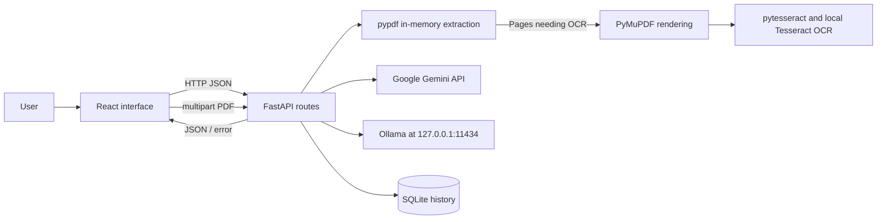

# AI Text Summarizer — Project Report

## Submission details

| Field | Fill in before submission |
| --- | --- |
| Student name and roll number | `[Your name and roll number]` |
| Institution and department | `[Institution / department]` |
| Internship organization | Blackbuck Engineers Pvt. Ltd. |
| Internship dates | `[Start date – end date]` |
| Faculty guide | `[Name]` |
| Industry mentor | `[Name]` |
| Submission date | `[Date]` |

> Replace all bracketed fields and add your own screenshots before submitting. This report describes the code present on 17 November 2026. It does not claim live provider testing or measured summary quality.

## Abstract

AI Text Summarizer is a local web application that accepts pasted text or text extracted from PDF pages and requests a summary from Google Gemini or an optional local Ollama model. The hybrid PDF pipeline uses `pypdf` for selectable text and local Tesseract OCR for pages with insufficient text. Users choose short, medium, or long output, review the result, and can copy, download, or share it. The application records successful summaries in a local SQLite database for later restoration or deletion.

## 1. Problem and objectives

Long articles and documents can take time to review. The project provides a simple interface for extracting readable PDF text and requesting a condensed version. Its objectives are to:

1. Accept plain text and text-based, scanned, or mixed PDF input.
2. Offer three approximate summary lengths and two provider choices.
3. Show useful failures for invalid input or an unavailable provider.
4. Keep a local record of successful summaries with restore and delete controls.
5. Provide basic output actions for copying, downloading, and sharing.

The application supports human review; it does not establish factual correctness automatically. Users should check generated summaries against source material before relying on them.

## 2. Scope and requirements

The frontend runs in a browser and communicates with a locally running FastAPI server. Gemini requires an API key and network access. Ollama requires a separately installed, running local server and a downloaded model. The default backend port is `8000`; the Vite development server normally uses a `517x` port accepted by the backend CORS rule.

Functional requirements implemented in the code are text submission, hybrid PDF extraction, provider and length selection, result display, local history CRUD, copy, text-file download, and share with clipboard fallback. Key constraints are a 5 MB default PDF upload limit, a 50,000-character extraction/input limit, and configurable page and OCR limits. The application has no accounts, batch processing, or summary quality scoring.

## 3. System architecture

For summarization, `frontend/src/services/api.js` posts the source text, length, and provider to `/api/summarize`. `backend/app/main.py` trims and limits the text, dispatches to the selected provider adapter, computes whitespace-based word counts, then calls the history service. If generation raises a handled error, no history row is written. For PDF input, `/api/extract-pdf` validates filename, MIME type, size, and content before `pypdf` extracts page text. The returned text fills the same editable input area; PDF extraction alone does not write history.

### Main modules

| Component | Code | Role |
| --- | --- | --- |
| Interface and actions | `frontend/src/App.jsx` | Input, upload, settings, result, messages, history controls |
| HTTP client | `frontend/src/services/api.js` | Calls backend endpoints and displays errors |
| API app | `backend/app/main.py` | CORS, health, summarization, router registration |
| Request/response models | `backend/app/models/` | Pydantic validation and API response shapes |
| PDF route/service | `backend/app/routes/pdf.py`, `backend/app/services/pdf_extraction.py` | Upload validation, selectable-text extraction and local OCR fallback |
| Provider services | `backend/app/services/gemini.py`, `backend/app/services/ollama.py` | Prompt construction and provider calls |
| History route/service | `backend/app/routes/history.py`, `backend/app/services/history.py` | SQLite persistence and retrieval/deletion |

## 4. Design and implementation

### 4.1 Frontend

The React component maintains the text, selected length/provider, summary, loading state, PDF status, and history list. It clears an old summary when input changes. PDF extraction replaces the text area content and asks the user to review it. Summary actions are enabled only when a summary exists. Deletion and clear-history actions ask for browser confirmation. The Web Share API is used where available; otherwise, the app tries the clipboard. Copy and share behavior can depend on browser permissions.

### 4.2 Backend and validation

Pydantic restricts `length` to `short`, `medium`, or `long` and `provider` to `gemini` or `ollama`. The summarization route rejects blank text with HTTP `400` and text above 50,000 characters with `413`. Provider configuration/unavailability returns `503` for the handled cases; a Gemini generation failure returns `502`. PDF validation rejects unsupported file types (`415`), empty or malformed files (`400`), and uploads beyond the configured limit (`413`). FastAPI also supplies schema validation responses for malformed requests.

### 4.3 Prompt and provider behavior

Both provider adapters request a faithful summary, treat source text as data, and ask the model to preserve important facts. The three lengths are approximate prompt targets: short 20–25%, medium 35–40%, and long 50–60% of source length. No algorithm enforces those percentages. The Gemini adapter reads `GEMINI_API_KEY` and optional `GEMINI_MODEL` from the backend environment and uses a 15-second SDK HTTP timeout. The Ollama adapter calls `/api/generate` with `stream: false`, uses `OLLAMA_MODEL`, and has a 120-second request timeout. Prompt wording is a mitigation attempt; it cannot guarantee immunity to misleading or malicious source text.

### 4.4 PDF extraction

The upload is processed in memory; the uploaded file is not permanently saved. The service uses `pypdf` to extract each page's selectable text. Pages without sufficient selectable text are rendered by PyMuPDF and processed by the locally installed Tesseract engine through `pytesseract`. The results are combined in page order with page warnings, method metadata, and an OCR page count. Encrypted files are rejected; page, upload, OCR and extracted-text limits restrict resource use. OCR may be incomplete, especially on low-quality or handwritten scans, so users must review the text.

On Windows, install Tesseract separately from a trusted distribution such as [UB Mannheim's Windows builds](https://github.com/UB-Mannheim/tesseract/wiki), then add its installation directory to PATH or set `TESSERACT_CMD` in `backend/.env` to the executable path. Restart the backend after configuration. Python dependencies are installed from `backend/requirements.txt`. See the README for commands and troubleshooting.

### 4.5 History and data handling

SQLite is initialized when history is used. Each successful summary row contains the full original text, summary, length, provider, original and summary word counts, and a UTC creation timestamp. Entries are listed newest first and can be fetched or deleted by ID; all entries can be cleared. The default file is `backend/data/history.sqlite3`, overridable with `HISTORY_DB_PATH`. SQL values use parameterized queries. The database is local and Git ignored, but it is not encrypted and the API has no authentication or user separation. Source text sent to Gemini leaves the local machine; Ollama generation uses a local HTTP endpoint if configured.

## 5. API summary

| Method and path | Input | Output / effect |
| --- | --- | --- |
| `GET /api/health` | None | Basic `{ status, application }` response |
| `POST /api/summarize` | JSON `text`, `length`, `provider` | Summary and word counts; saves successful result |
| `POST /api/extract-pdf` | Multipart `file` | Extracted text, counts, method, and page warnings |
| `GET /api/history` | None | All saved entries |
| `GET /api/history/{id}` | Integer ID | One saved entry or `404` |
| `DELETE /api/history/{id}` | Integer ID | Removes one entry or `404` |
| `DELETE /api/history` | None | Clears all entries |

The interactive schema is available at `http://localhost:8000/docs` while the backend runs.

## 6. Verification and results

These are the commands run in this workspace on 17 November 2026:

| Check | Command | Observed result | Coverage boundary |
| --- | --- | --- | --- |
| Backend unit tests | `.\.venv\Scripts\python.exe -m unittest discover -s tests -v` from `backend` | 3 tests passed | Provider calls are mocked; tests exercise history persistence, failed summary not saved, deletion/clear |
| Frontend production build | `npm run build` from `frontend` | Vite 5.4.21 build succeeded; 27 modules transformed | Confirms bundle compilation, not browser behavior |

The existing tests in `backend/tests/test_history.py` use a temporary database and replace provider calls with mocks. No live Gemini request, Ollama request, PDF extraction test, browser end-to-end test, load test, or summary-quality evaluation was performed as part of these Stage 5 checks. Do not present those as completed tests. A demonstration can be recorded in the spaces below after running it on the submission machine.

### Demonstration evidence to add

| Figure | What to capture | Status |
| --- | --- | --- |
| Figure 1 | Home page with input, settings, and empty result | `[Insert screenshot]` |
| Figure 2 | Generated summary with chosen length/provider | `[Insert screenshot after live run]` |
| Figure 3 | PDF extraction and editable extracted text | `[Insert screenshot after manual check]` |
| Figure 4 | Saved history and restored entry | `[Insert screenshot after manual check]` |
| Figure 5 | FastAPI `/docs` or health response | `[Insert screenshot]` |

Record the test input, selected model, date, and observed result alongside any live screenshots. Do not include an API key or private source text in screenshots.

## 7. Limitations and future work

- Generated text can omit, distort, or invent facts. Prompt instructions and length targets are not guarantees.
- Gemini needs a valid key, network access, model availability, and quota. Ollama needs its server and model installed separately.
- Encrypted PDFs are unsupported. OCR requires a separately installed local Tesseract engine; scan quality, language and complex layouts can affect accuracy and reading order.
- The app is designed for local use. History stores full source text without encryption, and the API has no account isolation or authentication.
- Automated tests currently cover history behavior only; provider integration, PDF edge cases, and browser flows need dedicated verification.
- There is no pagination or retention policy for history, and no automatic quality assessment of summaries.

Possible extensions are more comprehensive integration tests, history search/pagination, a configurable retention period, and a review workflow that compares summary claims with the source. These are proposed improvements, not implemented features.

## 8. Conclusion

The project integrates a React interface, FastAPI services, AI provider adapters, PDF text extraction, and local SQLite history into one working codebase. The observed automated checks establish that the history unit tests pass and the frontend builds. Provider availability, PDF behavior on specific files, and summary quality require separate live and manual evaluation.

## Appendix: local setup

Follow [README.md](README.md) for Windows commands, environment settings, and endpoint details. The example environment file is `backend/.env.example`; keep the real `backend/.env` private.
