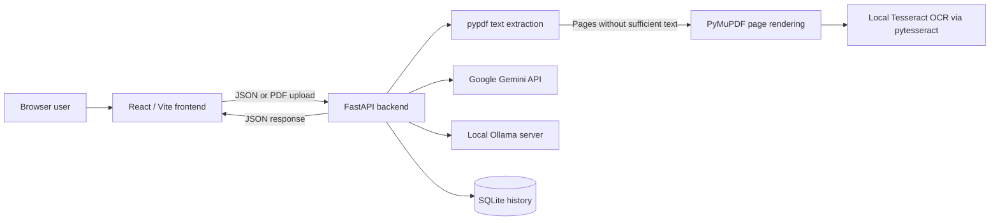

# AI Text Summarizer

A local web application for summarizing pasted text or text extracted from a PDF, including scanned pages using local OCR. It uses Google Gemini by default, offers an optional local Ollama provider, and saves successful summaries in a local SQLite history. This is a college internship project for Blackbuck Engineers Pvt. Ltd.

## Features

- Paste text or upload a text-based, scanned, or mixed PDF, review its extracted text, then choose a short, medium, or long summary.
- Select Google Gemini or an optional Ollama model.
- Restore, delete, or clear locally stored summaries.
- Copy, download as `.txt`, or share a summary through supported browser/device features.

## Architecture



The frontend sends requests to `http://localhost:8000` by default. The backend validates inputs, calls the selected summarization provider, and writes a history row after a successful response. PDF uploads are read in memory; their extracted text is placed in the text area. If that text is summarized, the full source text is saved in local history along with the summary.

## Run on Windows

Install Python 3.12 (recommended), Node.js 18 or newer, and npm. Obtain a Gemini API key from Google AI Studio for the default provider. Open PowerShell in the `AI-Text-Summarizer` folder and use two terminals.

**Terminal 1: backend**

```powershell
cd backend
py -3.12 -m venv .venv
.\.venv\Scripts\python.exe -m pip install -r requirements.txt
if (!(Test-Path .env)) { Copy-Item .env.example .env }
# Edit .env and set GEMINI_API_KEY to your own key.
.\.venv\Scripts\python.exe -m uvicorn app.main:app --reload --reload-dir app --port 8000
```

If the Python launcher (`py`) is unavailable, use an installed Python 3.12 executable to create `.venv`, for example `python -m venv .venv` if `python` points to that version. If `.env` already exists, keep it and edit it instead of running `Copy-Item`. Do not commit the key or put it in frontend code. `GEMINI_MODEL` defaults to `gemini-3-flash-preview`; set it to a model available to your API project if needed. Model access and quotas depend on your Google account.

**Terminal 2: frontend**

```powershell
cd frontend
npm install
npm run dev
```

Open the `Local` URL printed by Vite and keep both terminals running. The backend accepts local frontend origins on ports beginning `517` (for example `5173`). If you run the frontend elsewhere, update the backend CORS setting in `backend/app/main.py`. To point the frontend at another backend URL, set `VITE_API_BASE_URL` in its Vite environment before starting the dev server.

Check `http://localhost:8000/api/health` for backend status and `http://localhost:8000/docs` for interactive API documentation. The health endpoint does not test the Gemini key or Ollama connection.

## Use

1. Paste text, or choose a text-based or scanned PDF. For a PDF, inspect and edit the extracted text in the text area and check any page warnings.
2. Choose summary length and provider, then select **Generate Summary**.
3. Use **Copy**, **Download**, or **Share** for the result. Use **History** to restore or remove saved summaries.

The length choices are prompt targets, not guaranteed output word counts. Encrypted PDFs are rejected. The default PDF upload limit is 5 MB; extracted text and direct text input are limited to 50,000 characters. `PDF_MAX_UPLOAD_BYTES` can change the upload limit. OCR quality depends on scan quality, language, handwriting and layout; always review results. OCR runs locally, and only extracted text is sent to Gemini when you request a summary.

### Windows OCR setup

The Python requirements include `pypdf`, `PyMuPDF`, `pytesseract`, and Pillow. Tesseract itself is a separate program: install a trusted Windows Tesseract distribution (for example [UB Mannheim's Windows builds](https://github.com/UB-Mannheim/tesseract/wiki)) with the languages you need. The project does not install it automatically.

After installation, confirm the executable in PowerShell:

```powershell
& "C:\Program Files\Tesseract-OCR\tesseract.exe" --version
```

If Tesseract is not on PATH, set the actual installation location in `backend/.env`:

```env
TESSERACT_CMD=C:\Program Files\Tesseract-OCR\tesseract.exe
```

Restart the backend after editing `.env`. If extraction reports OCR is unavailable, check the executable path and installed language data. Scanned pages are rendered and processed locally; large documents are subject to page and OCR limits, and low-quality scans may produce incomplete text or warnings. Review the editable text before generating a summary.

Optional `.env` limits are `PDF_MAX_PAGES=30`, `PDF_MAX_OCR_PAGES=10`, and `PDF_OCR_TIMEOUT_SECONDS=120`. Raise these cautiously; OCR can use substantial time and memory.

### Optional Ollama setup

Install and start Ollama separately, pull a model, and set its installed model name in `backend/.env`:

```env
OLLAMA_MODEL=llama3.2
```

The backend calls `http://127.0.0.1:11434/api/generate`. If Ollama or the model is unavailable, the request returns an error. Gemini remains selectable. A live Ollama request was not part of the Stage 5 checks.

## API

| Method | Path | Purpose |
| --- | --- | --- |
| `GET` | `/api/health` | Basic backend health response |
| `POST` | `/api/summarize` | Summarize JSON `{ "text": "...", "length": "medium", "provider": "gemini" }` |
| `POST` | `/api/extract-pdf` | Extract text or use local OCR for scanned pages from multipart `file` upload |
| `GET` | `/api/history` | List stored summaries, newest first |
| `GET` | `/api/history/{id}` | Retrieve one summary |
| `DELETE` | `/api/history/{id}` | Delete one summary |
| `DELETE` | `/api/history` | Delete all summaries |

`length` accepts `short`, `medium`, or `long`; `provider` accepts `gemini` or `ollama`. Successful summaries are saved in `backend/data/history.sqlite3` by default. `HISTORY_DB_PATH` can override that location. The database and `.env` are Git ignored. There is no login or user separation, so anyone with access to the local application/database can access its history.

## Verification

From `backend`, run:

```powershell
.\.venv\Scripts\python.exe -m unittest discover -s tests -v
```

From `frontend`, run:

```powershell
npm run build
```

On 17 November 2026, the three backend history unit tests passed and the Vite production build succeeded in this workspace. The tests mock provider responses; they do not verify a live Gemini or Ollama request, PDF extraction, or browser interactions. See [PROJECT_REPORT.md](PROJECT_REPORT.md) for the test scope and limitations, and [VIVA_QUESTIONS.md](VIVA_QUESTIONS.md) for oral-exam preparation.
